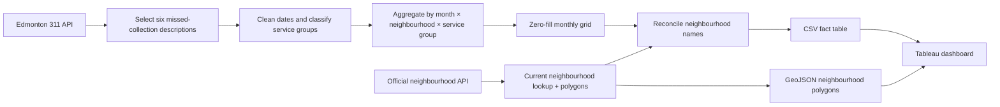

# Edmonton 311 Missed Waste Collection Analysis

Portfolio project analyzing City of Edmonton 311 requests related to missed residential waste collection using Python, GIS, and Tableau.

> **Interactive Tableau dashboard:** add the Tableau Public URL here after publishing the final dashboard.

## Project question

**Where and when are missed waste collection requests concentrated across Edmonton, and how do patterns vary by service type?**

The project combines City of Edmonton 311 service-request data with official neighbourhood boundaries, prepares a monthly analytical fact table, reconciles historical/current neighbourhood names, and exports Tableau-ready spatial and tabular files.

## Snapshot used in the notebook

The uploaded working notebook was run against a 311 snapshot spanning **January 2023 to October 2, 2026**. October 2026 is therefore a **partial month** and should not be compared directly with complete months.

For the six selected service descriptions, the notebook retained **42,530 requests with a neighbourhood value** and grouped them into four analytical service groups:

| Service group | Requests in notebook snapshot |
|---|---:|
| Garbage | 40,505 |
| Yard Waste | 1,028 |
| Residential General | 650 |
| Recycling | 347 |
| **Total** | **42,530** |

After monthly zero-filling, the Tableau fact table contains **58,880 rows**, representing 320 neighbourhood names × 46 months × 4 service groups. Zero-filled rows are visualization scaffolding; they are not additional 311 requests.

## Selected 311 request descriptions

The analysis intentionally uses only these six exact `service_description` values:

- `Missed Garbage Cart - Response Required`
- `Missed Garbage Cart - General Info`
- `Missed Res Collection General Info`
- `Missed Recycling - General Information`
- `Missed Yard Waste Response Required`
- `Missed Yard Waste General Information`

`Missed Res Collection General Info` is retained as a separate **Residential General** group because the waste stream is not explicit in the description.

## Data sources

- **City of Edmonton 311 Service Requests** — Socrata dataset `q7ua-agfg`  
  `https://data.edmonton.ca/resource/q7ua-agfg.csv`
- **City of Edmonton Neighbourhoods** — Socrata dataset `65fr-66s6`  
  `https://data.edmonton.ca/resource/65fr-66s6.csv`

The notebook queries the public APIs directly, so results can change as the source datasets update.

## Workflow



## Repository structure

```text
edmonton-311-missed-collection-analysis/
├── README.md
├── TABLEAU_SETUP.md
├── GITHUB_UPLOAD.md
├── requirements.txt
├── .gitignore
├── notebooks/
│   └── edmonton_311_missed_collection_analysis.ipynb
├── src/
│   └── prepare_tableau_data.py
├── data/
│   ├── processed/
│   │   └── edmonton_missed_waste_collection_monthly.csv   # generated
│   └── spatial/
│       └── edmonton_neighbourhoods.geojson                # generated
├── tableau/
│   └── README.md
└── images/
    └── README.md
```

## Tableau model

The dashboard uses two logical tables related by `neighbourhood_number`:

```text
Monthly 311 fact table                 Edmonton neighbourhoods
(many rows per neighbourhood)          (one polygon per neighbourhood)
             │                                      │
             └──── neighbourhood_number ────────────┘
                         Many → One
```

Current dashboard components:

- filled neighbourhood map of missed-collection requests;
- Top 10 neighbourhoods by request count;
- monthly request trend;
- filters for Year, Month, and Service Group;
- map-to-trend interaction using `Neighbourhood → Neighbourhood`.

See [`TABLEAU_SETUP.md`](TABLEAU_SETUP.md) for the exact Tableau configuration used during development.

## Neighbourhood reconciliation

Historical or source-system names are preserved in the fact table while selected aliases are mapped to the current official neighbourhood lookup for spatial display:

| 311 name | Current lookup name used |
|---|---|
| CHAPPELLE AREA | CHAPPELLE |
| HORSE HILL NEIGHBOURHOOD 1A | QUARRY RIDGE |
| OLIVER | WÎHKWÊNTÔWIN |

`LEWIS FARMS INDUSTRIAL` remained unmatched to a current official polygon in the notebook run. Its records remain in non-spatial totals/trends and are flagged as `No official polygon match` rather than being forced into a potentially incorrect boundary.

## Data-quality and interpretation notes

- The metric is **311 service requests related to missed collections**, not a verified count of unique missed pickups.
- Multiple contacts may relate to the same operational event.
- “General Info” and “Response Required” are preserved as source descriptions; the project does not assume they represent the same workflow state.
- Zero-filled rows mean **no matching selected request was observed in the extracted data for that month/neighbourhood/service group**. They do not prove that every source workflow was active in every period.
- Current neighbourhood polygons are used for mapping historical 311 names after explicit name reconciliation.
- October 2026 is partial in the notebook snapshot.

## Tools

`Python` · `pandas` · `requests` · `GeoPandas` · `Shapely` · `Socrata API` · `Tableau`

## Reproduce the data

Create an environment and install dependencies:

```bash
pip install -r requirements.txt
```

Then either run the notebook or execute:

```bash
python src/prepare_tableau_data.py
```

The script writes:

```text
data/processed/edmonton_missed_waste_collection_monthly.csv
data/spatial/edmonton_neighbourhoods.geojson
```

## Tableau Public

After the final dashboard is published:

1. paste the Tableau Public URL near the top of this README;
2. export a clean dashboard screenshot to `images/dashboard_preview.png`;
3. optionally save the packaged workbook as `tableau/Edmonton_311_Missed_Collections.twbx`.

GitHub stores the code, documentation, data outputs, screenshots, and workbook file; **the interactive Tableau experience itself is hosted on Tableau Public**.
